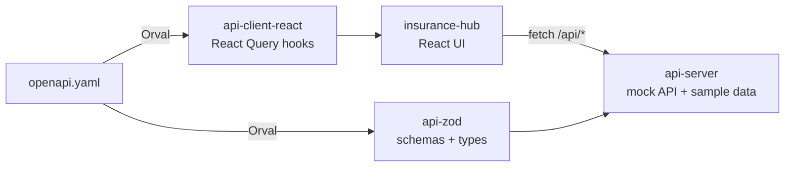

# CoverPilot — India SME Insurance Operations (Front-End MVP)

A front-end prototype of an operations workspace for SME insurance partners in India. CoverPilot shows how a broker or partner desk could manage **customers, quotes, policies and claims** from one screen, with a dashboard that surfaces what needs attention next.

> **This is a front-end project.** The React app in `artifacts/insurance-hub` is the product. The small Express server in `artifacts/api-server` is only a **mock API** that serves illustrative sample data from memory so the UI has something to talk to. There is no real backend, database, authentication or insurer integration. See [Scope and limitations](#scope-and-limitations).


---

## Table of contents

- [What the UI covers](#what-the-ui-covers)
- [Front-end design notes](#front-end-design-notes)
- [Tech stack](#tech-stack)
- [Project structure](#project-structure)
- [Getting started](#getting-started)
- [Mock API](#mock-api)
- [Scope and limitations](#scope-and-limitations)
- [License](#license)

---

## What the UI covers

A single-page app with a sidebar and six screens.

| Screen | Route | What you can do |
| --- | --- | --- |
| **Overview** | `/` | See key metrics (active policies, open claims, renewal value, pending actions, quote conversion), a recent-activity feed, and shortcuts into quotes, claims and renewals. |
| **Customers** | `/customers` | Browse the customer book, search by name, business or location, filter by business type, and add a customer through a form. |
| **Quotes** | `/quotes` | Browse and search quotes, open one for detail, create a quote from a coverage amount, and send a proposal. |
| **Policies** | `/policies` | Browse the policy register with search and a status filter, open a policy for detail, and print a policy summary. |
| **Claims** | `/claims` | Browse the claims queue with search and a status filter, open a claim for detail, and register a new claim. |
| **Settings** | `/settings` | Partner profile, operations preferences (email alerts, claims response target) and team access panels. |

### Behaviours worth seeing

- **Quote to proposal:** creating a quote prices it instantly, and sending a proposal moves that quote to `Under review`.
- **Claim intake:** a new claim lands in the queue as `Reported` and `Unassigned`, and is flagged **High** priority at ₹1,50,000 or more, otherwise **Medium**.
- **Live dashboard:** the metric cards and the activity feed update as you add customers, quotes and claims.

---

## Front-end design notes

- **Contract-first data layer.** The UI never hand-writes `fetch` calls. React Query hooks (`useListQuotes`, `useCreateClaim`, and so on) are generated from `lib/api-spec/openapi.yaml` with Orval, so types and endpoints stay in sync with the spec.
- **State.** Server data is cached by TanStack Query and refreshed after each write. Search text, filters, modals and form fields are local component state.
- **Resilient screens.** Every list has loading skeletons, an empty state with a call to action, and an error state with a retry button. A route-level error boundary catches page crashes and resets when you navigate.
- **Responsive.** The sidebar becomes a slide-in drawer on small screens, wide tables scroll horizontally, and modals open as bottom sheets on mobile.
- **India-specific formatting.** Amounts use the Indian digit grouping (₹1,85,000) and compact units such as `₹18.4 L` and `₹1.2 Cr`. Dates are formatted for `en-IN`.
- **Accessible controls.** Icon-only buttons carry `aria-label`s, and interactive elements have `data-testid` attributes, ready for end-to-end tests.
- **Reusable UI kit.** Shared building blocks (`PageHeader`, `Panel`, `StatusPill`, `SearchBox`, `FilterSelect`, `Field`, `Modal`, toast, empty, error and loading states) live in `src/components/ui-kit.tsx`, on top of a shadcn/ui primitive set in `src/components/ui/`.
- **Styling.** Tailwind CSS 4 with theme tokens defined in `src/index.css`, using Manrope for text and DM Mono for labels and figures.

---

## Tech stack

| Area | Technology |
| --- | --- |
| Language | TypeScript 5.9 |
| UI | React 19, shadcn/ui on Radix UI, lucide-react icons |
| Build tool | Vite 7 |
| Styling | Tailwind CSS 4 |
| Routing | wouter |
| Data fetching | TanStack Query 5, hooks generated by Orval from an OpenAPI 3.1 spec |
| Validation types | Zod schemas generated from the same spec |
| Mock API | Node.js, Express 5, pino (in-memory data only) |
| Monorepo | pnpm workspaces |

---

## Project structure

```text
.
├── artifacts/
│   ├── insurance-hub/        # THE FRONT END: React + Vite app
│   │   └── src/
│   │       ├── App.tsx       # routes, query client, error boundary
│   │       ├── pages/        # dashboard, customers, quotes, policies, claims, settings
│   │       ├── components/   # app-shell, ui-kit, error-boundary, ui/ (shadcn primitives)
│   │       ├── hooks/        # use-mobile, use-toast
│   │       └── index.css     # Tailwind theme tokens and fonts
│   ├── api-server/           # Mock API (Express, in-memory sample data)
│   └── mockup-sandbox/       # Replit component-preview canvas (design tooling only)
├── lib/
│   ├── api-spec/             # openapi.yaml + Orval config (source of truth for the data layer)
│   ├── api-client-react/     # generated React Query hooks
│   ├── api-zod/              # generated Zod schemas and types
│   └── db/                   # unused database scaffold (empty schema)
├── scripts/                  # workspace helper scripts
└── pnpm-workspace.yaml       # workspace globs and shared dependency catalog
```

How the pieces connect:



---

## Getting started

### Prerequisites

- **Node.js 24** (the version configured in `.replit`). The project also installed, type-checked, built and ran on Node 22 when tested.
- **pnpm 10.** Installing with npm or yarn is blocked by a `preinstall` guard.

### 1. Install

```bash
pnpm install
```

### 2. Start the mock API

The UI loads all its data from `/api`, so run the mock server first:

```bash
PORT=8080 pnpm --filter @workspace/api-server run dev
```

Check it: `curl http://localhost:8080/api/healthz` should return `{"status":"ok"}`.

### 3. Start the front end

In a second terminal:

```bash
PORT=5173 BASE_PATH=/ pnpm --filter @workspace/insurance-hub run dev
```

Open <http://localhost:5173>.

**Running outside Replit: add a dev proxy.** The app calls relative `/api/...` URLs and the Vite config does not proxy them, so the dev server would answer with its own HTML page. Add this inside the existing `server` block of `artifacts/insurance-hub/vite.config.ts`:

```ts
server: {
  // ...existing options
  proxy: {
    '/api': 'http://localhost:8080',
  },
},
```

On Replit this is not needed, because the platform routes `/api` to the API server.

### Other commands

| Command | Purpose |
| --- | --- |
| `pnpm run typecheck` | Type-check every package. |
| `PORT=3000 BASE_PATH=/ pnpm run build` | Type-check, then build everything. `PORT` and `BASE_PATH` are needed because the Vite configs require them to load. |
| `PORT=3000 BASE_PATH=/ pnpm --filter @workspace/insurance-hub run build` | Build only the front end into `artifacts/insurance-hub/dist/public` (static files). |
| `pnpm --filter @workspace/api-spec run codegen` | Regenerate the React Query hooks and Zod schemas after editing `openapi.yaml`. |

Commands use macOS/Linux shell syntax for environment variables. On Windows, use WSL or set the variables in your shell first.

### Environment variables

| Variable | Used by | Required | Notes |
| --- | --- | --- | --- |
| `PORT` | Front end, mock API | Yes | Both refuse to start without it. On Replit the mock API uses `8080` and the front end uses `22848`. |
| `BASE_PATH` | Front end | Yes | URL prefix the app is served from. Use `/`. |
| `LOG_LEVEL` | Mock API | No | pino log level. Defaults to `info`. |

### Changing the data layer

Edit `lib/api-spec/openapi.yaml` (keep `info.title` as `Api`), run the `codegen` command above, then use the regenerated hooks in the UI. Do not hand-edit files under `lib/*/src/generated/`, because they are overwritten on every run.

---

## Mock API

The mock server exists to drive the UI. Base path `/api`; the full contract is in [`lib/api-spec/openapi.yaml`](lib/api-spec/openapi.yaml).

| Method | Path | Used by |
| --- | --- | --- |
| `GET` | `/healthz` | Health check |
| `GET` | `/dashboard/summary` | Overview metrics |
| `GET` | `/activity` | Overview activity feed |
| `GET`, `POST` | `/customers` | Customers list and add-customer form |
| `GET`, `POST` | `/quotes` | Quotes list and new-quote form |
| `GET` | `/quotes/{id}` | Quote detail |
| `POST` | `/proposals` | "Send proposal" action |
| `GET` | `/policies` | Policies register |
| `GET`, `POST` | `/claims` | Claims queue and register-claim form |
| `GET` | `/claims/{id}` | Claim detail |

What it simulates:

- **Sample data:** 3 customers, 3 quotes, 4 policies, 3 claims and 4 activity items, reloaded on every start. The partner name (*BharatSure Partners*), the insurers (*BharatSure General*, *Aegis India*) and the IRDAI registration number are illustrative placeholders, not real entities.
- **Quote pricing:** a flat rate on coverage, rounded to the nearest rupee: **0.935%** for `Fleet Protect` (insurer *Aegis India*) and **0.72%** for every other product (insurer *BharatSure General*). New quotes start as `Awaiting documents` and expire after 7 days.
- **Proposals:** sending one returns a `Submitted` proposal and moves the quote to `Under review`.
- **Claims:** numbered `CLM-2026-xxxx`, starting as `Reported`, `Unassigned`, with the priority rule described above.
- **Dashboard metrics:** computed from the in-memory data, except *quote conversion*, which is a fixed 68%.

---

## Scope and limitations

CoverPilot is a front-end MVP built to demonstrate the product experience. Known gaps:

**Not built (out of scope for a front-end prototype)**
- No real backend: data lives in the mock server's memory and resets on every restart. A PostgreSQL/Drizzle scaffold exists in `lib/db` but has no tables and is not used.
- No authentication or user accounts, and no insurer, payment or KYC integrations.
- No policy issuance (a proposal does not create a policy), no renewal workflow, and no claim status transitions.
- No automated test suite yet. `pnpm run typecheck` is the main safety net.

**Placeholders and rough edges in the UI**
- Several dashboard items are static: the date heading, the "Good morning, Ananya" greeting, the *Book health* panel, the "Renewals to call" count and the claims badge in the sidebar. The partner and user shown in the sidebar and header are also hard-coded.
- The Settings screen is not connected to anything; edits are not saved.
- Some filter and form options do not match the statuses and products the mock API returns. For example, the Quotes filter offers `Draft`, `Quoted`, `Proposal sent`, `Won` and `Expired`, while the data uses `Awaiting documents`, `Ready to issue` and `Under review`. The new-quote product list also lacks `Fleet Protect`.
- "Export register" and "Print policy summary" open the browser print dialog.

**Mock API behaviour**
- An invalid request body returns a `500` instead of a `400` with a validation message.
- CORS is open to all origins.

---

## License

MIT, as declared in the root `package.json`.
